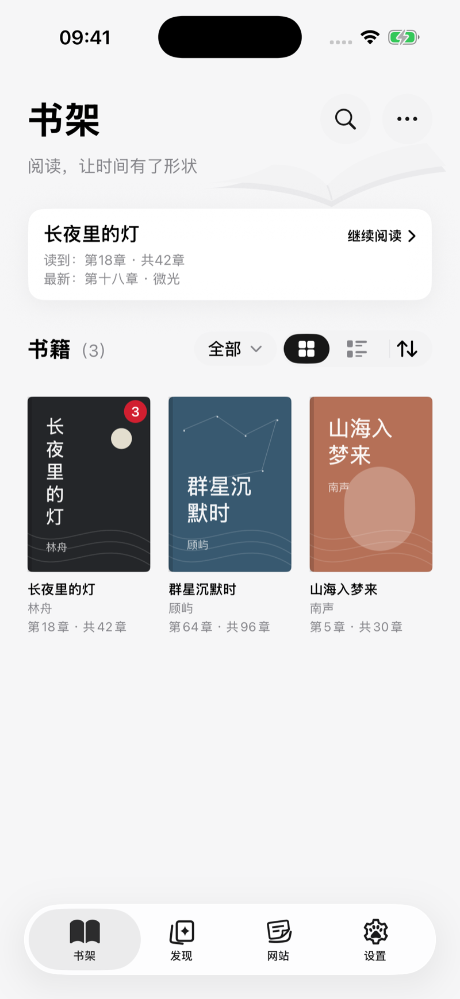
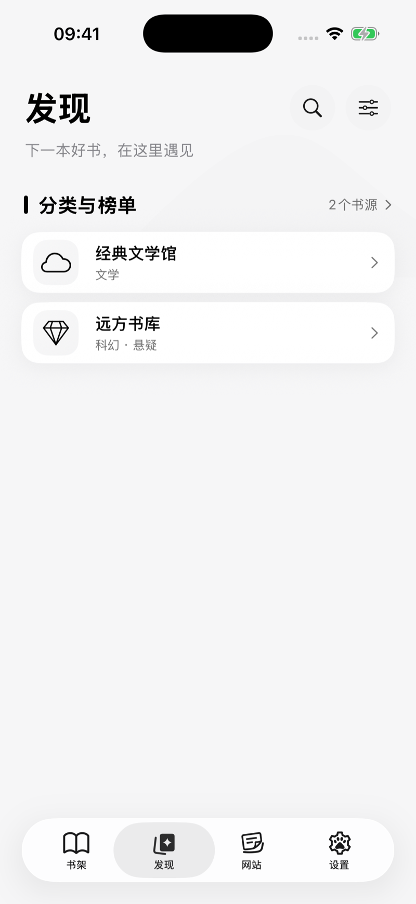
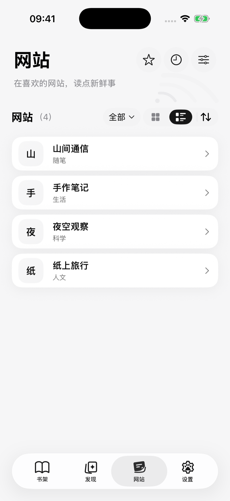
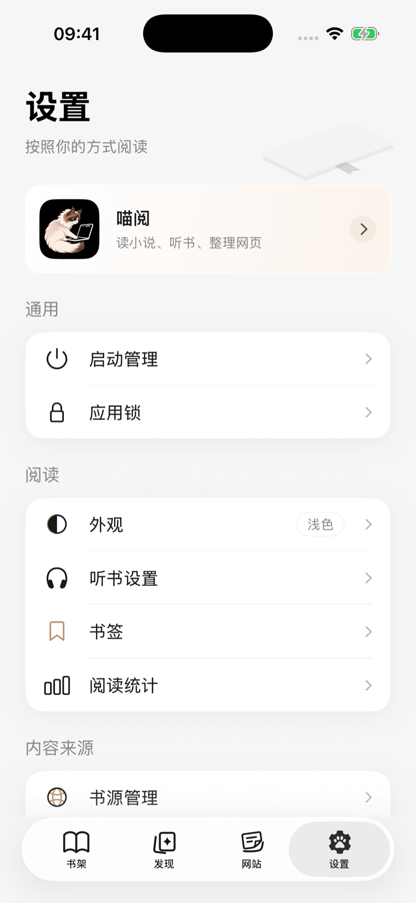

# 喵阅

喵阅是一款 iPhone 和 iPad 阅读器。把 TXT 或 EPUB 加入书架，就能离线阅读、做书签。导入自己的书源后，可以跨源搜书、追更、缓存章节，也可以让在线语音引擎从当前段落开始朗读。「网站」用于订阅文章、浏览图集、播放视频和收藏网页。

**0.0.41（构建 41）** · iOS / iPadOS 15.0 及以上 · 应用标识 `com.davidlabworks.miaoreader`。仓库提供未签名 IPA，安装到设备前需自行签名。[安装包目录](release/)

## 界面预览

以下截图取自 0.0.41 的 iPhone 模拟器。书籍和站点均为演示数据，实际内容由你导入。

| 书架 · 续读与分组 | 发现 · 分类与榜单 | 网站 · 我的站点 |
| :---: | :---: | :---: |
|  |  |  |

| 阅读 · 正文与菜单 | 听书 · 当前段落与播放控制 | 设置 · 通用与阅读偏好 |
| :---: | :---: | :---: |
|  |  |  |

## 第一次使用

| 想做什么 | 从这里开始 |
| --- | --- |
| 读本地书 | 在「书架 → 更多 → 导入本地书」选择 TXT 或 EPUB。也可在系统「文件」里用喵阅打开 EPUB，直接加入书架。 |
| 搜书或逛书单 | 到「设置 → 书源管理」导入并启用书源。在「书架」右上角搜索书名或作者，或到「发现」浏览书源提供的分类。 |
| 订阅网站 | 到「设置 → 网站源管理」导入网站源，再到「网站」点站点名称，打开文章列表或站点首页。 |
| 听正在读的书 | 在文字阅读页轻点中央，选「听书」，在播放器中点播放。点「声音引擎」可选引擎、试听并确认音色。 |
| 换设备 | 在旧设备的「数据备份与恢复」导出 JSON，在新设备上选择该文件，核对预览后点「恢复此备份」。 |

## 书架、搜书与发现

- **整理书架**　切换列表或宫格，创建、重命名和删除分组。每组可按最近阅读、最近更新、阅读或更新、书名、作者或自定义顺序排列。自定义顺序可拖动调整，同一本书在多个分组间共用该顺序。
- **续读与追更**　首页显示上次读到的章节和最新章节，点「继续阅读」回到原位置。下拉检查更新，或长按一本书刷新目录、移至分组、移出书架。详情页可单独设置该书是否允许更新。长按书籍选「设置封面」，可在图片搜索中选图。
- **跨源搜索**　多个书源并发搜索，结果随各源返回陆续显示，同一本书可汇集多个来源。可开启精准搜索，将范围限定为单个书源、一个或多个分组，查看已完成的源数，停止或继续搜索。支持分页的书源可加载更多结果，最近搜索可再次使用或清空。
- **发现与详情**　按书源浏览分类、榜单和书单，翻页查看更多结果。打开详情可查看作者、简介、最新章节和目录，直接阅读、加入书架或打开原网页。换源时查找同名作品，优先匹配作者。可比较候选来源和最新章节，选择后会验证目录和正文，并按新目录匹配原来的阅读位置。
- **目录与缓存**　目录可搜索章名、切换正序和倒序、定位当前章。在线章节可逐章下载，也可启动或停止全书缓存。已缓存的文字章节可离线打开。

## 本地书与阅读器

| 功能 | 可用操作 |
| --- | --- |
| TXT | 识别 UTF-8、UTF-16、GB18030、Big5 等编码。在本地书详情中选目录规则重新分章，也可拆分超长章节。 |
| EPUB | 阅读无 DRM 的 EPUB 2/3。原书模式保留 XHTML、CSS、表格和插图，可展开多级目录、按进度跳转、添加书签、调整字号、切换纸色或夜间主题、选择翻页或滚动。切换到文字模式可使用文字阅读器和听书。 |
| 翻页与导航 | 覆盖、滑动、仿真、滚动和无动画五种模式。分页时轻点两侧或左右滑动翻页，滚动模式上下连续阅读。轻点中央打开菜单，可跳章、搜索本章、开关自动阅读并调速。在线书支持重新获取本章、打开原网页，有章评规则时可查看评论。 |
| 字体与页面 | 使用系统或导入的字体，调整字号、字重、字距、行距、段距、缩进、两端对齐和章节标题。正文、页眉和页脚可分别设置边距，页眉页脚可选显示内容与分隔线。支持背景图、日夜主题、阅读亮度、繁转简和正文替换。 |
| 屏幕 | 可选择横竖屏方向、跟随系统或传感器，设置阅读时保持亮屏、隐藏状态栏或底部指示条。 |
| 漫画与插图 | 图片章节按原顺序纵向阅读，支持长图、上下章、书签、恢复位置和单张加载失败后重试。书内插图可放大、切换和保存到照片。全书缓存保存章节正文，漫画图片在阅读时按需加载。[漫画格式与兼容范围](docs/COMIC_READER.md) |
| 书签 | 在当前位置添加书签，编辑摘录和摘要，点书签跳回原处。「设置 → 书签」可统一管理，并导出为 JSON 或 Markdown。 |
| 阅读统计 | 查看今日和累计时长、阅读书数、近七天每日时长和连续阅读天数。阅读记录可按书名、时长或最后阅读排序，可删除、清空或关闭时长记录。 |

## 在线听书

- **内容与声音**　在线文字书、本地 TXT 和文字模式的 EPUB 均可听书。支持 LibreTTS、EdgeOne TTS、PPTBoard TTS、fengwm 的 Edge／Azure／火山三种引擎，以及万象 TTS。每个引擎分别记住选定的声音，可搜索和试听。试听和朗读时，应用会将相应文本发送给所选在线服务合成语音。
- **播放器**　竖屏和横屏均显示当前章节、段落和章内进度。可暂停、继续、切换上下章、结束朗读，在 0.5× 到 2.0× 之间调速。播放中确认新音色后，从下一句起换声。跨页句子连续朗读，章末自动接续下一章。
- **收起与后台**　收起播放器后可继续看书或返回书架。浮动播放器可拖动贴边，支持暂停、继续、重新打开和结束。后台可继续播放，锁屏或耳机可控制播放，也可设置用媒体上一首／下一首切章。
- **定时与中断**　本次播放可选预设时长或自定义 1–180 分钟。暂停时倒计时也会暂停，结束后清除。「听书设置」可调整保持亮屏、音频焦点和来电暂停。合成或播放中断时可从播放器重试。

## 网站、收藏与媒体

- **站点与分组**　「网站」展示已启用站点，可切换单列或双列、按组筛选，并为各组选择最近阅览、名称或自定义排序。长按站点可编辑或移动分组。「网站源管理」支持搜索、新建、编辑、启停、批量移动和删除。删除分组时可选择保留其中的网站。
- **文章与订阅**　支持 RSS 列表、规则解析的文章列表、单网址站点和自定义首页。可按栏目浏览、下拉刷新、加载下一页，在正文底部上拉进入下一篇。有搜索规则的站点可从「更多 → 源内搜索」查找文章。列表样式、预加载、缓存优先和源登录由站点规则控制。
- **收藏与历史**　可收藏文章、编辑收藏信息、搜索收藏与浏览记录、分享链接或在浏览器打开原文。「网站」可单独关闭网页浏览历史。
- **图集、视频与下载**　可浏览图集并保存图片。视频支持播放控制、拖动进度、倍速、全屏和页内小窗。下载文件可选择保存位置。站点提供对应操作时，网页可发起搜书、打开登录页，或按书籍链接匹配书源并加入书架。
- **网站源编辑**　可从文件、URL 或粘贴的 JSON 导入，预览时勾选要添加的站点。可编辑分组、图标、栏目、列表与正文规则、请求头、Cookie、JavaScript 和网页样式，或导出单个及全部网站源。

## 书源、规则与调试

| 工具 | 功能 |
| --- | --- |
| 书源导入 | 支持文件、URL、粘贴 JSON、相机扫码、从照片识别二维码，以及兼容的 `legado://`、`yuedu://` 链接。预检显示有效和失效项，可只选新增或更新，并决定是否保留已有名称、分组和启用状态。 |
| 系统分享导入 | 在浏览器或其他应用的分享菜单中把 HTTP(S) 规则链接发送给喵阅。下次打开喵阅时可预览内容，再确认导入。 |
| 书源管理与编辑 | 可搜索、排序、批量分组、启停和删除书源，单独开关「发现」。详情显示搜索、发现、详情、目录和正文的规则配置。支持表单和 JSON 编辑、格式化、复制和导出，规则可使用 CSS、XPath、JSONPath、正则和 JavaScript。 |
| 测试、登录与验证 | 批量快速测试使用指定关键词，可复查失败项并选择停用或删除。单源调试依次检查搜索、详情、目录和第一章正文，可看各阶段耗时、结果与错误。需要登录或验证的书源可打开对应页面，登录 Cookie 与后续阅读请求共享。 |
| 规则订阅 | 订阅书源或净化规则地址，可手动检查和导入更新，或按设定的间隔自动检查、静默更新。 |
| 替换净化 | 新建、复制、排序、启停和测试规则。可按普通文本或正则替换章节标题、正文，限定本书或自定义作用范围，设置执行顺序与超时。支持文件、URL、JSON、二维码导入及导出。 |
| TXT 目录规则 | 编写章节匹配表达式，用示例文本测试，启停或调整优先顺序。支持导入、导出 JSON 和恢复内置规则。 |

## 文件、备份与迁移

- **本地书籍文件**　在「设置 → 本地书籍文件」导入和管理 TXT、EPUB，按名称或大小排序、加入书架、重命名、导出原文件或批量删除。从书架移除一本书后，仍可从这里找到保留的原文件。
- **缓存正文导出**　在「设置 → 缓存正文导出」查看每本网络书已缓存的章数，按目录顺序导出 TXT。文件中会标记缺失章节，方便判断还要补下哪些章。
- **完整备份**　在「数据备份与恢复」导出一个 JSON，可带走书架与分组、目录、进度、书签、阅读与搜索记录、网站收藏与历史、源与规则、阅读及网络偏好、自定义字体与背景。本地 TXT、EPUB 原文件也写入备份，包括尚未上架的文件。
- **恢复行为**　选择备份文件后先校验并展示预览。点「恢复此备份」会用备份覆盖当前书架、源、记录和设置，同名本地书使用备份中的版本。在线章节正文需要重新缓存，网站需要重新登录。备份可能含自定义请求头或服务器凭据，分享前可先检查。
- **单独导入源**　只想添加或更新源时，导入书源或网站源 JSON 即可。相同地址的源可以更新，已有书架和阅读记录会保留。

## 外观、应用锁与维护

| 设置入口 | 可调整的内容 |
| --- | --- |
| 外观与启动管理 | 应用可跟随系统，或使用浅色、深色、E-Ink 模式。可从四个首页标签中指定启动页，并决定启动时是否检查书架更新、检查全部书籍或只检查已读到最新章的书。 |
| 应用锁 | 设置、更改六位数字锁定码，支持的设备可启用 Face ID。点书架右上角的锁可立即锁定，也可设置切到后台后立即或延迟锁定。启用后重新启动应用需要解锁。旧版密码可验证并更换为数字码。 |
| 缓存管理 | 查看已缓存章数和占用空间，调整容量上限及前后预读章数，分别清理章节和网页缓存。 |
| 网络连接与高级网络 | 调整请求超时、搜索并发数和证书兼容开关，编辑默认 User-Agent、全局代理、自定义 Hosts，可按页恢复默认设置。 |
| 整理数据库与日志 | 手动整理数据库可回收空闲空间。「日志与诊断」可开关记录、按级别筛选、搜索、导出或清空日志，保留最近 500 条。网络日志省略请求正文和请求头，并隐藏 URL 查询参数。 |
| 关于喵阅 | 点设置首页的应用卡片，可查看版本与构建号、分享诊断摘要，找到项目源码、社区反馈、开源许可和数据与隐私说明。 |

## 构建与许可

在 macOS 上用 Xcode 打开 `Legado.xcodeproj`，选择 `Legado` Scheme 和 iPhone 或 iPad 模拟器即可运行。安装到自己的设备时需配置签名团队。核心逻辑与应用模型可在仓库根目录运行 `swift test` 验证。[开发指南](docs/DEVELOPMENT.md) · [贡献指南](CONTRIBUTING.md)

喵阅基于 Aminark 的 legado-ios 开发，采用 GNU GPL v3 许可。网络书籍与订阅内容由用户导入的源提供。[上游项目](https://github.com/Aminark/legado-ios) · [项目许可证](LICENSE) · [第三方声明](THIRD_PARTY_NOTICES.md)
